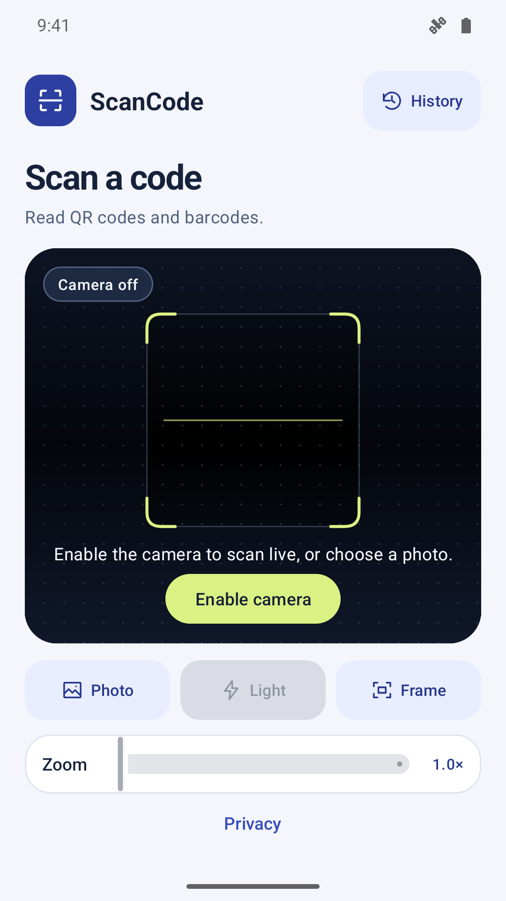
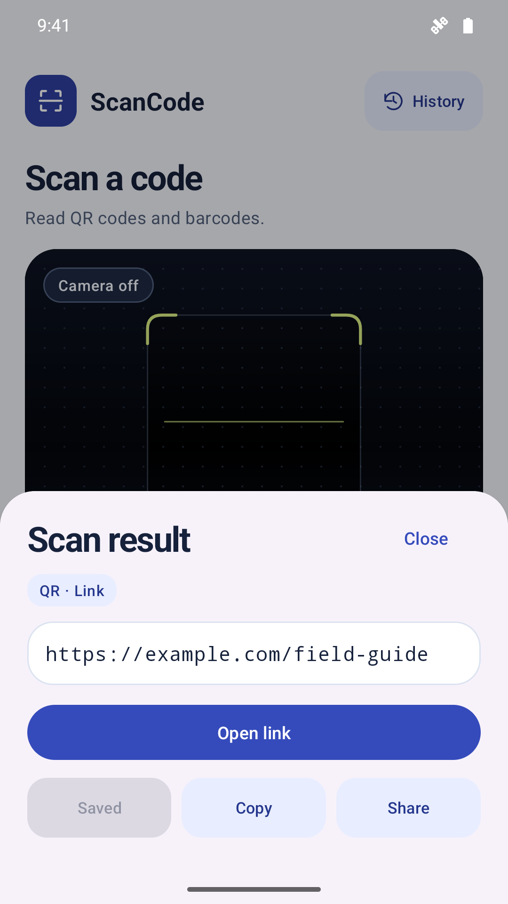
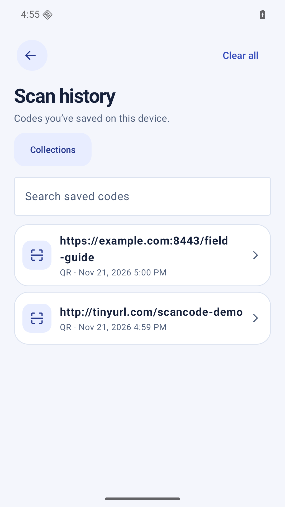

<p align="center">
  
</p>

<h1 align="center">ScanCode</h1>

<p align="center">Scan QR codes and barcodes from your camera or photos. Review each result and keep the codes you need.</p>

<p align="center">
  
  
  
</p>

## Features

- Scan live with tap-to-focus, pinch-to-zoom, a zoom slider, torch control on compatible devices, and three viewfinder shapes.
- Pick a photo with Android's system picker. When a photo contains multiple readable codes, choose which one to open.
- Review the raw content and format before copying, sharing, or opening a supported action. Web links, phone numbers, messages, maps, and Wi-Fi codes get relevant actions.
- Inspect the destination and HTTP or HTTPS in an on-device link review. The result flags recognized shorteners, literal IPs, and internationalized domain names.
- Save up to 200 scans in recent history, and organize codes into named collections that persist independently of history.
- Scan offline with a bundled ML Kit model. The interface follows the device's light or dark theme and supports English and Spanish.

The scanner supports QR, Aztec, Data Matrix, PDF417, EAN-8, EAN-13, UPC-A, UPC-E, Code 39, Code 93, Code 128, Codabar, and ITF. [ML Kit format details](https://developers.google.com/ml-kit/vision/barcode-scanning/)

## Build and run

**Windows with Docker Desktop**

```powershell
.\build.ps1
```

**Android Studio or command line**

Use JDK 17, Android SDK Platform 37.0 and Build Tools 37.0.0. Open the root project in Android Studio and run the `app` configuration, or run the Gradle Wrapper from the root.

```sh
bash ./gradlew :app:lintDebug :app:testDebugUnitTest :app:assembleDebug :app:bundleRelease
```

On Windows outside Docker, replace `bash ./gradlew` with `.\gradlew.bat`.

| Output | Location |
| --- | --- |
| Installable debug APK | `app/build/outputs/apk/debug/app-debug.apk` |
| Unsigned release App Bundle | `app/build/outputs/bundle/release/app-release.aab` |
| Android Lint | `app/build/reports/lint-results-debug.html` |
| Unit tests | `app/build/reports/tests/testDebugUnitTest/index.html` |

Install the debug build on a connected Android 8.0 or later device or emulator with `adb install -r app/build/outputs/apk/debug/app-debug.apk`. Tap **Enable camera** for live scanning, or tap **Photo** to scan without camera access.

### Test app launch on an emulator

From the project root on x86-64 Windows with Docker Desktop, run:

```powershell
.\build.ps1 -InstrumentedTest
```

Docker downloads the emulator and an Android 11 AOSP Automated Test Device image on the first build. The local emulator runs in software mode, so startup can take several minutes. The report is at `app/build/reports/androidTests/connected/debug/index.html` and the emulator log is at `app/build/reports/androidTests/emulator.log`.

GitHub Actions starts an Android 16 emulator on its Ubuntu runner with hardware acceleration. Both environments run `:app:connectedDebugAndroidTest`, which opens ScanCode from its launcher entry and checks that the scanner title and **History** button are visible. CI keeps the reports in the `scancode-instrumented-test-reports` artifact.

## How it works

ScanCode is an Android app written in Kotlin with Material 3 and Android Views. CameraX and ML Kit map detections into preview coordinates so the viewfinder can choose the nearest centered code. Android's photo picker grants access to the selected image. A bounded decoder handles image rotation and large photos off the UI thread.

History and collections use app-private storage. History remains compatible with saves from version 1.0. Version 1.1 targets Android 16 while keeping Android 8.0 as its minimum.

ScanCode is a noncommercial project with no advertising.

## Project resources

- [Using ScanCode](docs/usage.md)
- [Release preparation and device QA](docs/release.md)
- [Play Store listing copy and assets](docs/store/README.md)
- [Privacy policy](PRIVACY.md)
- [Changelog](CHANGELOG.md)
- [Contribution guide](CONTRIBUTING.md)
- [Security policy](SECURITY.md)

The [Android build workflow](.github/workflows/android.yml) runs lint, JVM tests, and the emulator startup test. It builds the APK and unsigned App Bundle and keeps reports as workflow artifacts.
